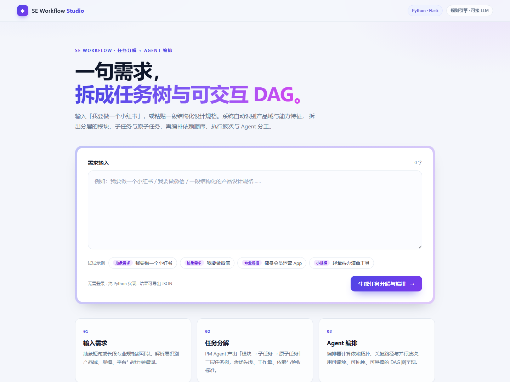
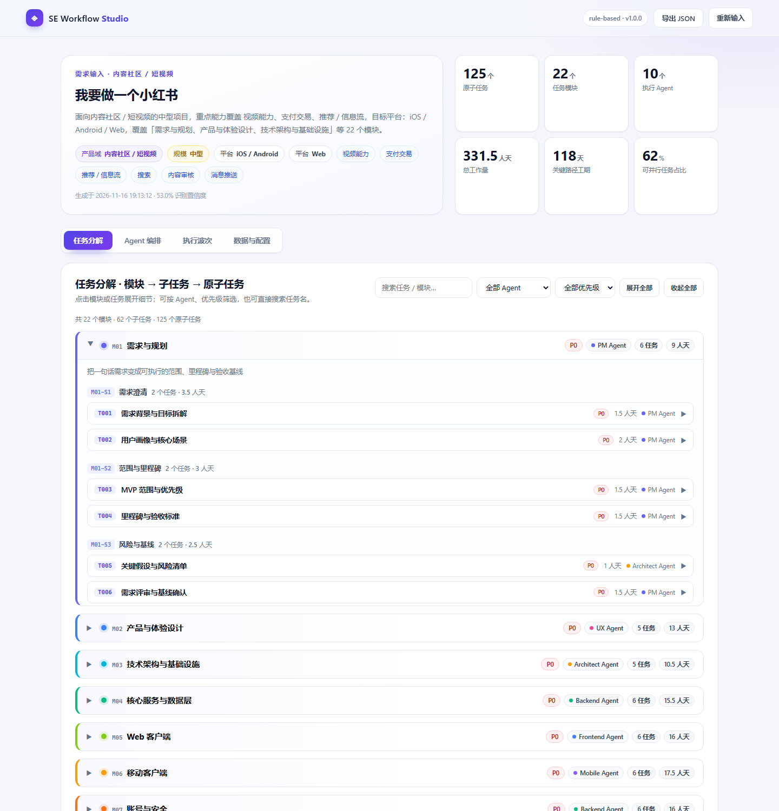
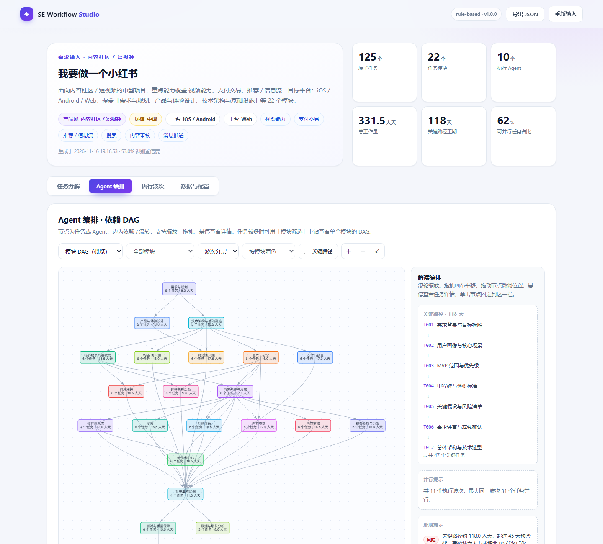
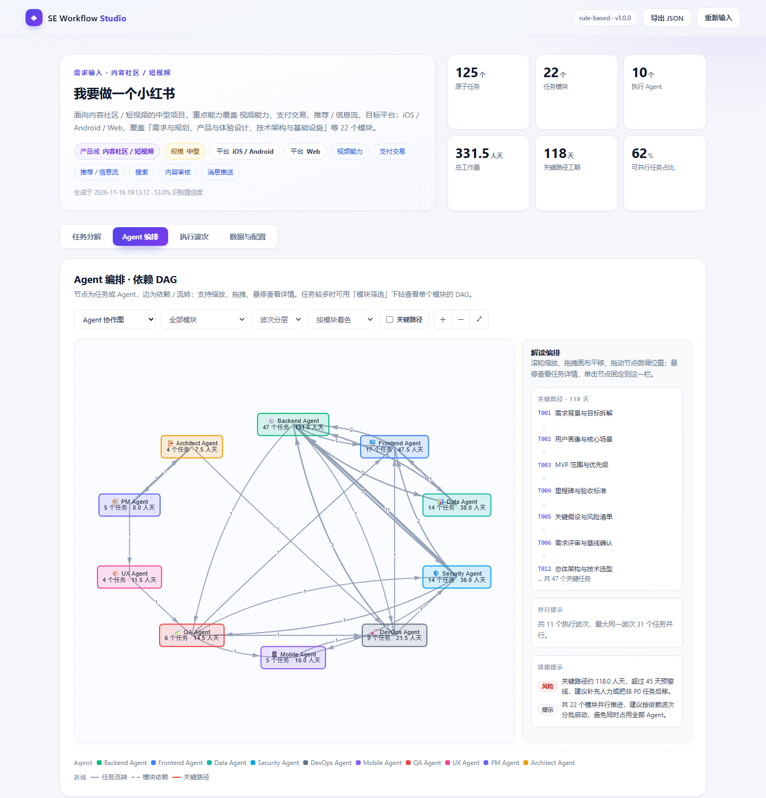
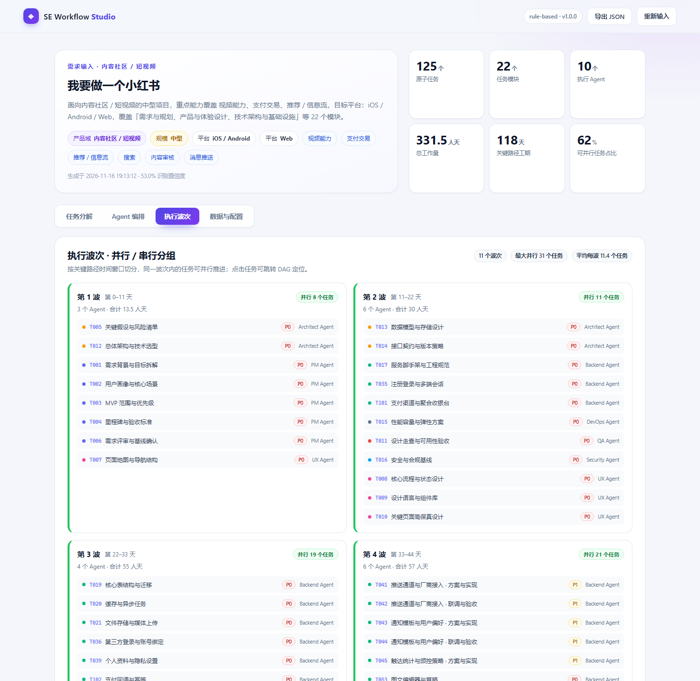

# SE Workflow Studio

> 用 Python + Flask 把 SE Workflow 的「任务分解 + Agent 编排」做成一个可交互网页。
> 输入一句需求，自动产出三层任务树与可缩放、可拖拽、可悬停的 Agent 编排 DAG。

- **输入**：`我要做一个小红书` / `我要做微信` / 一段结构化的产品设计规格
- **任务分解**：模块 → 子任务 → 原子任务，含优先级、工作量、依赖、验收标准、执行 Agent
- **Agent 编排**：模块概览 DAG、任务明细 DAG（可下钻到单个模块）、Agent 协作图
- **纯规则驱动**：不依赖大模型也能离线跑通；`engine/llm.py` 预留真实模型接入点
- **零前端构建**：Flask + Jinja2 + 原生 JS，vis-network 已本地化，无需联网



## 快速开始

环境要求：Python 3.10+（开发环境为 Python 3.14 + Flask 3.1）。

```bash
cd se-workflow
pip install -r requirements.txt
python app.py
```

浏览器打开 <http://127.0.0.1:5000>。

Windows 也可以直接双击 `start_windows.bat`（会自动检查 Flask 并启动）。
需要换端口时：

```bash
# Windows PowerShell
$env:PORT=8000; python app.py
# macOS / Linux
PORT=8000 python app.py
```

## 页面截图

### 任务分解：模块 → 子任务 → 原子任务



### Agent 编排：模块概览 DAG



任务量较大时可在工具栏选择「模块筛选」下钻，查看单个模块内部的 6~8 个原子任务 DAG；
也可以切换「波次分层 / 力导向」布局和「模块 / Agent / 优先级 / 波次」四种着色方式。

### Agent 协作图



### 执行波次：并行 / 串行分组



## 使用流程

1. **输入页**：输入短句或长规格；点击示例可快速填充；`Ctrl/Cmd + Enter` 提交。
2. **任务分解页**：查看模块卡片，点击展开子任务与原子任务；支持搜索、按 Agent / 优先级筛选、一键展开收起。
3. **Agent 编排页**：默认展示模块级 DAG 概览；点击模块节点可查看该模块的任务并跳转到任务明细；
   勾选「关键路径」高亮红色节点与边；悬停节点查看完整任务详情。
4. **执行波次页**：按关键路径时间窗口分组，展示每一波的任务、Agent 与工作量，点击任务可跳回 DAG 定位。
5. **数据与配置页**：查看配置文件说明、LLM 接入状态，复制或下载完整方案 JSON。

## 目录结构

```text
se-workflow/
├── app.py                     # Flask 入口：页面路由 + JSON API + 内存方案存储
├── requirements.txt           # 仅依赖 Flask（图库已本地化）
├── start_windows.bat          # Windows 一键启动
├── config/                    # ★ 配置区：模板、领域、Agent、规则
│   ├── __init__.py            #   统一导出配置
│   ├── agents.py              #   Agent 类型 / 职责 / 配色 / 关键词推断
│   ├── domains.py             #   产品域关键词、能力特征、特征→模块映射
│   ├── modules.py             #   任务模块模板（三层任务 + 模块依赖）
│   └── rules.py               #   规模系数、优先级、波次与风险阈值、示例
├── engine/                    # 引擎：输入 → 分解 → 编排 → 渲染
│   ├── models.py              #   Task 数据结构与序列化
│   ├── parser.py              #   输入解析（领域/规模/平台/能力/补充需求）
│   ├── breaker.py             #   任务分解（PM Agent 模拟）
│   ├── orchestrator.py        #   Agent 编排（拓扑、CPM、波次、负载、风险）
│   ├── render.py              #   可视化视图模型（任务/模块/Agent 三张图）
│   ├── llm.py                 #   大模型接入层（默认关闭，失败自动回退）
│   └── pipeline.py            #   流水线编排
├── templates/                 # base / index / result / message 页面
├── static/
│   ├── css/style.css
│   ├── js/home.js             #   首页交互
│   ├── js/result.js           #   任务树、DAG 图、波次、导出
│   └── vendor/vis-network.min.js  # vis-network 9.1.9（MIT，本地化）
├── tests/test_engine.py       # 12 个引擎与路由测试
└── docs/                      # README 截图
```

## 引擎设计

整条流水线分成四层，每层只依赖上一层的输出，方便替换或接入真实大模型：

```text
需求文本
  → RequirementParser    识别产品域 / 规模 / 平台 / 能力特征 / 补充需求
  → TaskBreaker          选择模块并展开为三层任务树，生成依赖边
  → Orchestrator         拓扑校验、关键路径 CPM、执行波次、Agent 负载、风险提示
  → PlanRenderer         生成任务/模块/Agent 三张图与图例，输出可直接 JSON 化的方案
```

### 1. 输入解析

- 领域识别：对 `config/domains.py` 的关键词计分（产品名加权），命中越多置信度越高；
- 规模识别：领域默认规模 + 文本信号（`高并发/海量/多端` → L，`MVP/轻量/小工具` → S）；
- 平台识别：`iOS / Android`、`Web`、`微信小程序`；
- 能力特征：支付、推荐、直播、AI、多租户、离线、安全合规等 16 类，附带命中关键词；
- 补充需求：从结构化输入的分行短句中提取「需要/支持/包含…」的能力点，最多补 3 个模块，
  避免专业规格被领域模板“平均化”。

### 2. 任务分解（PM Agent 模拟）

模块选择 = **核心模块** + **领域模块** + **能力特征模块** + **补充需求模块**，再按规模过滤。

- 核心模块：需求与规划、体验设计、技术架构、核心服务、Web/移动客户端、账号安全、集成联调、测试、部署、数据分析；
- 领域模块：由 `config/domains.py` 的 `modules` 指定（如社交域含即时通讯、好友、群聊、朋友圈、音视频通话）；
- 能力模块：支付、推荐、搜索、审核、直播、AI 助手等由能力关键词自动引入；
- 模块有两种展开方式：
  - `subtasks`：显式写出三层结构（核心模块与重点业务模块）；
  - `capabilities`：只写能力点，由引擎自动生成「方案与实现 / 联调与验收」两个原子任务。

依赖关系有两条规则，保证 DAG 清晰：

1. 模块出口固定为最后一个原子任务，跨模块依赖只连「上游出口 → 下游入口」；
2. 并行模块内部先分流、最后汇合到“联调与验收”任务。

### 3. Agent 编排

- **拓扑校验**：Kahn 算法排序，发现环直接抛出可读错误；
- **关键路径**：CPM 计算最早/最晚开始、总时差，回溯出关键路径；
- **执行波次**：按总工期切成约 11 个时间窗，每个窗口内的任务视为同一波次可并行推进；
- **Agent 负载**：统计各 Agent 的任务数、工作量、覆盖模块与占比；
- **Agent 协作图**：把跨 Agent 的任务依赖聚合成交接边，标注交接次数；
- **风险提示**：关键路径过长、单 Agent 负载过高、并行模块过多、P0 占比过高等。

### 4. 可视化渲染

`engine/render.py` 输出前端直接可用的视图模型：

- 任务节点：所属模块色、Agent 色、优先级色、波次色四套配色，tooltip 含完整任务信息；
- 模块节点：模块级依赖、任务数、工作量、是否在关键路径上；
- Agent 节点：职责、任务数、工作量、覆盖模块；
- 所有 tooltip 在 Python 侧统一做 HTML 转义，前端只负责渲染。

前端使用本地化的 vis-network 渲染：分层布局按波次/依赖排列，力导向布局用于探索；
支持缩放、拖拽、悬停、点击固定详情、关键路径高亮、模块下钻与图例切换。

## 配置方式

所有可调内容都在 `config/`，不需要改算法。

### 新增一个任务模块

在 `config/modules.py` 的 `MODULES` 中追加：

```python
"coupon": {
    "name": "优惠券",
    "summary": "优惠券发放、核销与风控",
    "phase": 3,                 # 0 需求 → 5 上线
    "priority": "P1",
    "agent": "backend",
    "depends": ["cart_order"],  # 依赖已有模块 key；"*business" 表示全部业务模块
    "business": True,
    "mode": "parallel",         # parallel：能力点并行分支；sequential：子任务串行
    "capabilities": ["优惠券模板与发放", "核销与叠加规则", "防刷与风控"],
}
```

要精确控制三层结构时，把 `capabilities` 换成 `subtasks`：

```python
"subtasks": [
    {
        "name": "发券",
        "atoms": [
            {"name": "券模板设计", "desc": "……", "effort": 2, "agent": "backend",
             "acceptance": "模板字段覆盖业务场景"},
        ],
    },
]
```

### 新增一个产品域

在 `config/domains.py` 的 `DOMAINS` 中增加关键词与默认模块，并在 `FEATURE_MODULES` 中补充能力映射即可。

### 调整 Agent / 排期规则

- `config/agents.py`：Agent 名称、职责、颜色、关键词推断规则；
- `config/rules.py`：规模系数（S=0.6 / M=1.0 / L=1.4）、优先级颜色、波次数量、风险阈值、首页示例。

## 大模型接入

默认 `RuleOnlyAdapter`，不发任何外部请求。需要接入 OpenAI 兼容接口时设置：

```bash
SE_WORKFLOW_LLM=openai
SE_LLM_BASE_URL=https://api.openai.com/v1
SE_LLM_API_KEY=sk-...
SE_LLM_MODEL=gpt-4o-mini
```

适配器只负责补充需求模块：返回结果会做名称/能力点校验，最多合并 3 个模块；
任何网络或格式错误都会静默回退到规则结果，网页流程不会被打断。
实现自己的适配器只需继承 `engine/llm.py` 的 `LLMAdapter` 并替换 `get_adapter()`。

## HTTP API

| 方法 | 路径 | 说明 |
| --- | --- | --- |
| `GET` | `/` | 输入页 |
| `POST` | `/analyze` | 表单提交，生成后 302 跳转结果页 |
| `GET` | `/result/<plan_id>` | 结果页（内存保留最近 24 个方案） |
| `POST` | `/api/analyze` | `{"requirement": "..."}` → 完整方案 JSON |
| `GET` | `/api/health` | 健康检查 |

`/api/analyze` 返回的核心字段：

```json
{
  "profile": {"domain": {}, "scale": {}, "platforms": [], "features": [], "custom_modules": []},
  "modules": [{"id": "M01", "key": "requirements", "task_count": 6, "effort": 9.0}],
  "tree": [{"type": "module", "children": [{"type": "subtask", "children": ["任务"]}]}],
  "tasks": [{"id": "T001", "priority": "P0", "effort": 1.5, "depends_on": [], "critical": true}],
  "edges": [{"from": "T001", "to": "T002", "kind": "flow"}],
  "orchestration": {"critical_path": [], "waves": [], "agents": [], "agent_flow": {}, "risks": []},
  "graph": {"task": {}, "module": {}, "agent": {}},
  "stats": {"tasks": 125, "modules": 22, "total_effort": 331.5, "critical_days": 118.0}
}
```

## 测试

```bash
python -m unittest discover -s tests -v
```

覆盖：领域识别、三层任务树完整性、DAG 一致性（边都存在、依赖可回查）、波次覆盖全部任务、
Agent 覆盖全部任务、规模差异、专业规格补充模块、JSON 可序列化、页面与 API 路由。

## 验收对照

| 验收标准 | 实现 / 证据 |
| --- | --- |
| 输入「我要做一个小红书」，产出任务分解与 Agent 编排 DAG | 首页示例一键填充；结果为内容社区域、22 个模块、125 个原子任务，模块 DAG 与任务 DAG 均可交互 |
| 输入「我要做微信」或具体专业需求，同样产出结果 | 微信识别为社交域并自动补充即时通讯、音视频通话、支付等模块；专业规格会额外解析出补充模块 |
| 任务分解为清晰分层结构 | 模块 → 子任务 → 原子任务三层折叠树，含优先级、工作量、依赖、验收标准、执行 Agent |
| Agent 编排以图呈现且可交互 | vis-network 三张图：模块概览、任务明细（模块下钻）、Agent 协作；支持缩放/拖拽/悬停/关键路径/四种着色 |
| 全流程 Python 实现，网页完成输入 → 分解 → 编排查看 | Flask 路由 + JSON API + 前端渲染；`python app.py` 即可 |

## 已知限制

- 规则引擎基于关键词与模板，抽象程度极高的需求可能识别不准；真实生产建议接入 LLM 适配器。
- 结果保存在进程内存（最近 24 个），重启后旧链接失效；需要持久化可接数据库。
- 任务量较大时（100+ 原子任务）请使用「模块筛选」下钻查看任务明细，避免整图过密。
- 开发服务器仅用于本地演示，生产部署请使用 gunicorn / waitress 等 WSGI 服务器。

## 第三方资源

- [vis-network 9.1.9](https://visjs.github.io/vis-network/)（MIT License），已放在 `static/vendor/`，无需联网加载 CDN。
