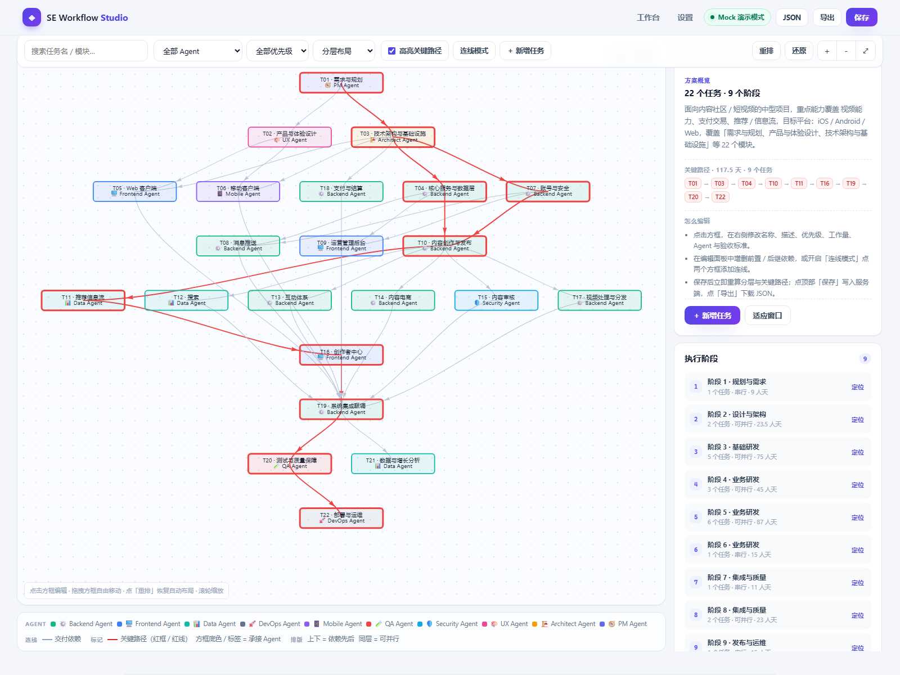
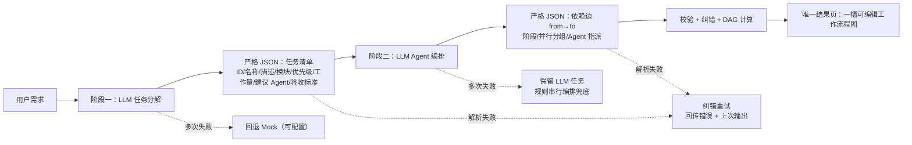

# SE Workflow Studio · V5

> 输入一句需求，由**大模型分两阶段**完成「任务分解 + Agent 编排」，最终只呈现为**一幅可编辑的工作流程图**。

- **方框 = 分解出来的任务**：名称、描述、所属模块、优先级、工作量、验收标准、承接 Agent。
- **连线 + 排版 = Agent 编排结果**：依赖方向、串行 / 并行、按执行阶段分层、每个任务的承接 Agent。
- **点击方框即可编辑**：改字段、增删任务、增删依赖；保存后实时重算分层与关键路径，并同步底层 JSON。
- **真实 LLM**：兼容 OpenAI / DeepSeek / 通义 / Moonshot 等 OpenAI 风格接口，Key 只放在 `.env`。
- **无 Key 可演示**：Mock 模式复用项目自带的规则引擎，仍能生成一张有业务含义的流程图。




> 截图为 Mock 演示模式；结果页会明确标注「Mock 规则模拟」，不会伪装成 LLM 结果。真实 LLM 模式下，方框、连线与分层规则完全一致。

---

## 目录

- [快速开始](#快速开始)
- [配置 `.env`](#配置-env)
- [工作原理：两阶段 LLM](#工作原理两阶段-llm)
- [工作流程图怎么看](#工作流程图怎么看)
- [节点编辑操作](#节点编辑操作)
- [Mock 模式](#mock-模式)
- [目录结构](#目录结构)
- [主要模块](#主要模块)
- [HTTP 接口](#http-接口)
- [数据结构](#数据结构)
- [测试](#测试)
- [扩展点](#扩展点)
- [常见问题](#常见问题)
- [设计取舍与限制](#设计取舍与限制)

---

## 快速开始

环境要求：**Python 3.10+**（开发环境为 Python 3.14 + Flask 3.1）。

```bash
# 1. 安装依赖
pip install -r requirements.txt

# 2. 复制配置模板，填入自己的 Key
#    Windows
copy .env.example .env
#    macOS / Linux
cp .env.example .env

# 3. 编辑 .env，至少填写 LLM_API_KEY
#    （默认使用 DeepSeek，也可以换成任意 OpenAI 兼容服务）

# 4. 启动
python app.py
```

浏览器打开 <http://127.0.0.1:5000>。

Windows 也可以直接双击 `start_windows.bat`：脚本会检查依赖，并在缺少 `.env` 时提示配置。

### 不配置 Key 也能看效果

- 首页点击 **「Mock 演示」**，或直接把 `LLM_MOCK_MODE=true` 写入 `.env`；
- 系统会使用规则引擎生成演示方案，不发起任何网络请求；
- 首页与设置页会明确显示当前处于 `Mock 模式（未配置 Key）`。

---

## 配置 `.env`

`config/settings.py` 通过 `python-dotenv` 读取项目根目录的 `.env`；如果没有安装 `python-dotenv`，会退化为内置的 `KEY=VALUE` 解析器，保证仍可启动。

| 变量 | 默认值 | 说明 |
| --- | --- | --- |
| `LLM_API_KEY` | 空 | **必填**。服务商 API Key；不要提交到仓库 |
| `LLM_BASE_URL` | `https://api.deepseek.com/v1` | OpenAI 兼容接口地址 |
| `LLM_MODEL` | `deepseek-chat` | 模型名 |
| `LLM_TEMPERATURE` | `0.2` | 采样温度，结构化生成建议 0.1–0.4 |
| `LLM_TIMEOUT` | `90` | 单次请求超时（秒） |
| `LLM_MAX_RETRIES` | `2` | JSON 解析 / 校验失败后的纠错重试次数（总尝试次数 = 1 + 该值） |
| `LLM_ALLOW_MOCK` | `true` | 调用失败时是否自动回退 Mock |
| `LLM_MOCK_MODE` | `false` | 强制 Mock（离线演示） |
| `LLM_JSON_MODE` | `true` | 是否发送 `response_format={"type":"json_object"}`；不支持时自动去掉重试 |
| `HOST` / `PORT` | `127.0.0.1` / `5000` | Web 服务监听地址 |

### 常见服务商示例

| 服务商 | `LLM_BASE_URL` | `LLM_MODEL` 示例 |
| --- | --- | --- |
| OpenAI | `https://api.openai.com/v1` | `gpt-4o-mini` |
| DeepSeek | `https://api.deepseek.com/v1` | `deepseek-chat` |
| Moonshot | `https://api.moonshot.cn/v1` | `moonshot-v1-8k` |
| 通义千问（DashScope 兼容模式） | `https://dashscope.aliyuncs.com/compatible-mode/v1` | `qwen-plus` |
| 本地 Ollama | `http://127.0.0.1:11434/v1` | `qwen2.5:7b` |

### 密钥安全

- `.gitignore` 已忽略 `.env`、`.env.local`、`data/` 与常见缓存目录；
- 代码、仓库与导出的方案 JSON 中**不包含 Key**；
- 网页设置页只显示掩码后的 Key（如 `sk-1****cdef`）；
- 日志只记录阶段、耗时、任务数、Token 用量等元信息，不打印请求头；
- 方案里只保存模型名与 `base_url`，便于排查配置问题。

修改 `.env` 后**重启服务**生效。

---

## 工作原理：两阶段 LLM



### 阶段一：任务分解

Prompt 位于 `config/prompts.py`，要求模型只输出 JSON：

```json
{
  "summary": "一句话目标",
  "domain": "内容社区",
  "scale": "中型",
  "platforms": ["Web", "iOS / Android"],
  "tasks": [
    {
      "id": "T01",
      "name": "需求澄清与验收标准",
      "description": "明确目标、范围、关键产出与不做清单",
      "module": "规划与需求",
      "priority": "P0",
      "effort": 2.5,
      "agent": "pm",
      "acceptance": "范围说明与验收标准通过评审"
    }
  ]
}
```

约束：任务数量 8–24 个；`id` 从 `T01` 连续编号；`priority` 只能是 `P0/P1/P2`；`effort` 为 0.5–10 人天；`agent` 必须来自 `config/agents.py` 的 Agent 清单。

### 阶段二：Agent 编排

以阶段一的任务清单为输入，要求模型输出：

```json
{
  "summary": "先架构后并行研发，最后联调发布",
  "edges": [
    {"from": "T01", "to": "T02", "kind": "dependency", "label": ""}
  ],
  "stages": [
    {"level": 0, "name": "规划与设计", "parallel": false, "nodes": ["T01", "T02"]}
  ],
  "assignments": [
    {"node": "T01", "agent": "pm", "role": "负责需求边界与验收口径"}
  ],
  "parallel_groups": [
    {"name": "前后端并行", "nodes": ["T03", "T04"]}
  ]
}
```

- `kind` 可选 `dependency`（交付依赖）、`flow`（流转/交接）、`review`（评审/验收）；
- 边必须构成 DAG；阶段必须覆盖全部任务；`assignments` 必须覆盖全部任务；
- 阶段层级会被当作**排版提示**，但依赖边永远是硬约束：如果 LLM 的阶段划分与边冲突，会以边为准自动调整并压缩为连续层级。

### JSON 校验、纠错与降级

1. `engine/json_utils.py` 从模型输出中提取 JSON，兼容代码围栏、前后解释文字、中文引号、尾逗号；
2. `engine/schema.py` 做字段归一化：别名映射、类型收敛、ID 去重、边端点对齐、环检测、Agent 名称归一化；
3. 解析或校验失败时，`engine/llm_json.py` 会把**错误信息 + 上一次输出**回传给模型，要求只修复 JSON，最多重试 `LLM_MAX_RETRIES` 次；
4. 仍失败时：
   - 阶段一失败 → 整个方案回退 Mock（`LLM_ALLOW_MOCK=true` 时），结果页显示降级原因；
   - 阶段二失败 → **保留 LLM 分解出的真实任务**，编排退化为按任务顺序的串行依赖；
   - `LLM_ALLOW_MOCK=false` 且阶段一失败 → 页面 / API 返回友好错误，不静默失败。

常见的 HTTP 错误会转换成可读提示：401 Key 无效、403 无权限、404 base_url/模型不存在、429 限流、5xx 服务暂不可用、超时、输出被长度截断等。

---

## 工作流程图怎么看

| 视觉元素 | 含义 |
| --- | --- |
| 方框 | 一个 LLM 分解出的任务 |
| 方框第二行 `🧭 PM Agent` | 承接该任务的 Agent 类型 |
| 方框边框颜色 | 由 Agent 主题色决定（见图例） |
| 红色边框 / 红色连线 | 关键路径（CPM 计算，时差为 0） |
| 上下层级 | 依赖先后；同一层可并行推进 |
| 实线 | 交付依赖 `dependency` |
| 虚线 | 流转 / 交接 `flow` |
| 点线 | 评审 / 验收 `review` |
| 悬停方框 | 完整描述、模块、优先级、工作量、Agent、阶段、时间窗口、前置/后继、验收标准 |
| 点击方框 | 打开右侧编辑面板，并高亮其全部上下游 |
| 点击连线 | 查看 / 删除这条依赖 |
| 左侧阶段列表 | 每个执行阶段的任务数、工作量、是否可并行；点「定位」飞到该阶段 |
| Agent 负载 | 每个 Agent 的任务数、总工作量、占比 |
| 可并行任务 | LLM 显式标注的并行组 + 同层自动识别结果 |

工具栏支持：搜索、按 Agent / 优先级筛选、分层 / 力导向布局切换、关键路径高亮、缩放与适应窗口。

**自由拖拽**：分层模式下，每个方框都可以直接拖到任意位置；拖拽后节点会被标记为手动固定，后续编辑、筛选、重排之外的刷新不会把它吸回原位。点工具栏「重排」可清除手动位置，恢复自动分层排版。手动坐标会随方案一起保存（节点 JSON 的 `x` / `y` / `pinned` 字段），刷新页面后仍然保留。

**排版策略**：层级由依赖关系计算，同层节点用重心法排序以减少连线交叉；画布按可用宽度自动选择一个"舒适缩放"，避免横向裁切，竖向看不完时可以拖拽平移。点「适应窗口」（⤢）可一次看全图。

---

## 节点编辑操作

| 操作 | 方式 |
| --- | --- |
| 修改任务字段 | 点击方框 → 右侧表单修改名称、描述、模块、优先级、工作量、承接 Agent、职责、验收标准 → **保存修改** |
| 增删前置依赖 | 编辑面板的依赖区：点依赖 chip 删除，或在下拉框选择任务添加 |
| 增删后继依赖 | 在编辑面板的后继区点 chip 删除；或在另一个任务的前置依赖中加入当前任务 |
| 两个方框快速连线 | 点工具栏 **「连线模式」** → 点起点方框 → 点终点方框；按 `Esc` 退出 |
| 自由移动方框 | 直接拖拽方框；位置会自动持久化到节点 `x` / `y` / `pinned`，保存后刷新仍保留 |
| 恢复自动排版 | 点工具栏 **「重排」**，清除手动坐标并重新按依赖分层 |
| 新增任务 | 工具栏 **「＋ 新增任务」**；若当前选中了某个任务，会自动建立「选中任务 → 新任务」的依赖 |
| 删除任务 | 编辑面板底部 **「删除任务」**（同时删除相连依赖） |
| 保存到服务端 | 顶部 **「保存」** 或 `Ctrl/Cmd + S`；保存后服务端重新校验并重算图指标 |
| 导出 JSON | 顶部 **「导出」** 或 JSON 弹窗里的 **「下载 plan.json」** |
| 查看底层 JSON | 顶部 **「JSON」**，可复制完整方案 |
| 放弃编辑 | 工具栏 **「还原」**，恢复为上次生成 / 保存的方案 |

编辑保存后：

1. 立即在前端重算**层级、关键路径、Agent 负载、可并行组、统计**；
2. 方框内容与连线实时刷新；
3. `state.plan`（即底层 JSON）同步更新；
4. 点顶部「保存」后调用 `PUT /api/plan/<id>`，服务端再次校验、重算并落盘到 `data/plans/<id>.json`。

新增依赖时前端会阻止自环、重复边和任何会形成环的连线；服务端保存时也会再做一次环检测与移除。

---

## Mock 模式

触发条件（任一）：

- 未配置 `LLM_API_KEY`；
- `LLM_MOCK_MODE=true`；
- 首页点击「Mock 演示」；
- 真实调用失败且 `LLM_ALLOW_MOCK=true`（结果页会显示降级原因）。

Mock 的数据来自 `engine/legacy/` 中保留的规则引擎：它读取 `config/modules.py` 的领域模块模板，将模块展开为任务、依赖、优先级与工作量，再转换成与 LLM 输出同构的 V5 流程图结构。

特点：

- 不联网、不消耗 Token；
- 仍然是“方框 = 任务、连线 = 依赖、分层 = 阶段”，可完整演示编辑 / 保存 / 导出；
- 结果页会明确标注 `Mock 规则模拟`，不会伪装成 LLM 结果。

---

## 目录结构

```text
se-workflow/
├── app.py                     # Flask 入口：页面 + JSON API + 方案存储
├── requirements.txt           # Flask / python-dotenv / requests
├── .env.example               # 配置模板（复制为 .env）
├── .gitignore                 # 忽略 .env、data/ 等
├── start_windows.bat          # Windows 一键启动
│
├── config/                    # ★ 配置层（改这里即可调优，不用动引擎）
│   ├── settings.py            #   .env → Settings；API Key 掩码
│   ├── prompts.py             #   两阶段 Prompt + 纠错 Prompt
│   ├── agents.py              #   Agent 类型 / 职责 / 颜色 / 别名归一化
│   ├── rules.py               #   任务数量、工作量、阶段名、示例需求
│   ├── domains.py             #   规则引擎（Mock）使用的领域关键词
│   └── modules.py             #   规则引擎（Mock）使用的任务模块模板
│
├── engine/
│   ├── pipeline.py            #   两阶段编排 + 降级策略
│   ├── llm_client.py          #   OpenAI 兼容客户端（超时 / 重试 / 错误映射）
│   ├── llm_json.py            #   JSON 解析 + 纠错重试
│   ├── json_utils.py          #   从脏输出中提取 JSON
│   ├── decompose.py           #   阶段一：任务分解
│   ├── orchestrate.py         #   阶段二：Agent 编排
│   ├── schema.py              #   归一化 / 校验 / 计划组装 / 编辑回写
│   ├── graph.py               #   DAG 校验、分层、CPM 关键路径、并行分组
│   ├── render.py              #   页面统计 / 图例 / 阶段视图模型
│   ├── mock.py                #   规则引擎 → V5 流程图
│   ├── store.py               #   内存 LRU + data/plans/*.json 持久化
│   └── legacy/                #   Mock 使用的早期规则引擎
│
├── templates/
│   ├── base.html              #   全局头部 / 导航 / 模式徽标
│   ├── index.html             #   输入页（需求 + 示例 + 配置状态）
│   ├── result.html            #   唯一结果页：一幅可编辑工作流程图
│   ├── settings.html          #   LLM 配置 / 测试连接 / Prompt 预览
│   └── message.html           #   提示页
│
├── static/
│   ├── css/style.css
│   ├── js/home.js             #   首页交互 + 两阶段加载提示
│   ├── js/result.js           #   vis-network 图、编辑、保存、导出
│   ├── js/settings.js         #   测试连接
│   └── vendor/vis-network.min.js
│
├── tests/test_engine.py       # 37 个测试（含本地假 LLM 服务）
└── data/                      # 运行数据（git 忽略）
    └── plans/<plan_id>.json   # 生成 / 保存的方案
```

---

## 主要模块

| 层 | 文件 | 职责 |
| --- | --- | --- |
| 配置层 | `config/settings.py` | 读取 `.env`、类型收敛、掩码 Key、运行模式 |
| 配置层 | `config/prompts.py` | 两阶段 Prompt、纠错 Prompt（集中管理） |
| LLM 客户端 | `engine/llm_client.py` | `/chat/completions` 调用、超时、HTTP 错误翻译 |
| 任务分解 | `engine/decompose.py` + `schema.normalize_decomposition` | 阶段一调用与字段校验 |
| Agent 编排 | `engine/orchestrate.py` + `schema.normalize_orchestration` | 阶段二调用、边/阶段/指派归一化 |
| 图计算 | `engine/graph.py` | 环检测、拓扑排序、最长路径分层、CPM、关键路径 |
| 计划组装 | `engine/schema.py` | 合并两阶段、补齐统计 / 图例 / 阶段 / 并行组 |
| 渲染视图 | `engine/render.py` + `static/js/result.js` | 服务端视图模型 + vis-network 交互图 |
| 持久化 | `engine/store.py` | `data/plans/*.json` + 内存 LRU |
| Web | `app.py` | 页面路由、API、错误处理 |

---

## HTTP 接口

| 方法 | 路径 | 说明 |
| --- | --- | --- |
| `GET` | `/` | 输入页；显示 LLM 配置状态 |
| `POST` | `/analyze` | 表单提交；`mode=llm` 或 `mode=mock`；成功 302 到结果页 |
| `GET` | `/result/<plan_id>` | 唯一结果页：一幅可编辑工作流程图 |
| `GET` | `/settings` | 配置状态 / 测试连接 / Prompt 预览 |
| `POST` | `/api/analyze` | JSON `{ "requirement": "...", "mock": false }` → `{ plan_id, plan }` |
| `GET` | `/api/plan/<plan_id>` | 读取方案 |
| `PUT` | `/api/plan/<plan_id>` | 保存编辑后的方案 `{ "plan": {...} }`，服务端重算并返回 `{ ok, plan, view, stats }` |
| `POST` | `/api/llm/test` | 测试 LLM 连通性；未配置 Key 返回 400 |
| `GET` | `/api/settings` | 配置状态（Key 已掩码） |
| `GET` | `/api/health` | 健康检查 + 当前模式 / 模型 |

错误返回统一为 JSON：

```json
{
  "error": "API Key 无效或已过期（401）",
  "hint": "请检查 .env 中的 LLM_API_KEY 是否正确、是否有多余空格。",
  "detail": "…"
}
```

页面路径返回 HTML 提示页，`/api/*` 路径返回 JSON。

---

## 数据结构

完整方案由 `engine/schema.finalize_plan()` 产出，前端与导出 JSON 使用同一结构：

```json
{
  "meta": {
    "version": "2.0.0",
    "engine": "llm",
    "engine_label": "LLM 两阶段编排",
    "model": "deepseek-chat",
    "base_url": "https://api.deepseek.com/v1",
    "generated_at": "2026-01-01 12:00:00",
    "duration_ms": 12345,
    "degraded": false,
    "degraded_reason": "",
    "llm_calls": [
      {"stage": "decompose", "status": "ok", "attempts": 1, "latency_ms": 8000, "usage": {}},
      {"stage": "orchestrate", "status": "ok", "attempts": 1, "latency_ms": 9000, "usage": {}}
    ],
    "edited": false,
    "plan_id": "a1b2c3d4e5f6"
  },
  "requirement": {
    "raw": "我要做一个小红书",
    "summary": "一句话目标",
    "domain": "内容社区",
    "scale": "中型",
    "platforms": ["iOS / Android", "Web"]
  },
  "nodes": [
    {
      "id": "T01",
      "name": "需求澄清与验收标准",
      "description": "…",
      "module": "规划与需求",
      "priority": "P0",
      "effort": 2.5,
      "agent": "pm",
      "agent_name": "PM Agent",
      "agent_color": "#6366f1",
      "agent_icon": "🧭",
      "agent_role": "需求澄清、范围管理、验收把关",
      "role": "负责需求边界与验收口径",
      "acceptance": "范围说明与验收标准通过评审",
      "level": 0,
      "stage": "阶段 1 · 规划与需求",
      "critical": true,
      "earliest_start": 0,
      "earliest_finish": 2.5,
      "latest_start": 0,
      "slack": 0,
      "depends_on": [],
      "successors": ["T02"],
      "x": 0,
      "y": 0,
      "pinned": false,
      "order": 0
    }
  ],
  "edges": [
    {"id": "E001", "from": "T01", "to": "T02", "kind": "dependency", "label": "", "critical": true}
  ],
  "stages": [
    {"level": 0, "name": "阶段 1 · 规划与需求", "parallel": false, "node_ids": ["T01"], "effort": 2.5}
  ],
  "critical_path": ["T01", "T02"],
  "parallel_groups": [
    {"name": "前后端并行", "level": 2, "node_ids": ["T03", "T04"], "source": "llm"}
  ],
  "stats": {
    "nodes": 1,
    "edges": 1,
    "agents": 1,
    "modules": 1,
    "stages": 1,
    "total_effort": 2.5,
    "critical_days": 2.5,
    "critical_nodes": 1,
    "parallel_nodes": 0,
    "parallel_ratio": 0,
    "avg_parallelism": 1,
    "p0_nodes": 1
  },
  "agents": [
    {
      "id": "pm",
      "name": "PM Agent",
      "role": "需求澄清、范围管理、验收把关",
      "color": "#6366f1",
      "icon": "🧭",
      "node_ids": ["T01"],
      "effort": 2.5,
      "p0_count": 1,
      "node_count": 1,
      "share": 1
    }
  ],
  "legend": {
    "agents": [{"id": "pm", "label": "PM Agent", "color": "#6366f1", "icon": "🧭"}],
    "priorities": [],
    "edge_kinds": [{"kind": "dependency", "label": "交付依赖", "dashed": false, "dotted": false}],
    "critical": {"label": "关键路径", "color": "#ef4444"},
    "stages": [{"level": 0, "name": "阶段 1 · 规划与需求"}]
  },
  "warnings": []
}
```

编辑保存时，服务端通过 `engine/schema.rebuild_plan()` 重新计算层级、关键路径、Agent 聚合与统计，避免前端与后端数据不一致。

---

## 测试

```bash
python -m unittest discover -s tests -v
```

测试覆盖 37 个用例：

- JSON 提取 / 尾逗号修复 / 非法输出；
- 字段别名、ID 去重、工作量与优先级收敛、Agent 名称归一化；
- DAG 环移除、边端点对齐、阶段层级提示、关键路径；
- Mock 模式（小红书 / 微信 / 专业规格）的节点、边、Agent、阶段、图例；
- 本地假 LLM 服务：两阶段成功、JSON 纠错重试、阶段二降级、阶段一失败回退 Mock、禁止 Mock 时抛错、`response_format` 不支持时自动回退；
- Flask 页面、`/api/analyze`、`/api/plan/<id>` 保存、404、空输入、健康检查；
- 方案存储的磁盘往返（服务重启后结果链接仍可打开），以及编辑保存后拖拽坐标 `x` / `y` / `pinned` 的保留；
- Key 掩码与配置状态不泄露完整 Key。

测试不依赖真实 API Key，也不会访问外网。

---

## 扩展点

| 想改什么 | 改哪里 |
| --- | --- |
| 换模型 / 换服务商 | `.env` 的 `LLM_BASE_URL`、`LLM_MODEL` |
| 调整任务数量、工作量边界 | `config/rules.py` 的 `MIN_TASKS` / `MAX_TASKS` / `MIN_EFFORT` / `MAX_EFFORT` |
| 改 Prompt 口径 | `config/prompts.py` |
| 增加 Agent 类型 | `config/agents.py` 的 `AGENTS`；Prompt 与前端下拉框自动读取 |
| 改阶段默认名称 | `config/rules.py` 的 `PHASE_LABELS`；前端 `static/js/result.js` 中有同名的兜底常量 |
| 改图样式 / 交互 | `static/js/result.js` 的 `networkOptions()` / `nodeView()` / `edgeView()` |
| 改页面样式 | `static/css/style.css` |
| 改 Mock 的任务模板 | `config/modules.py`、`config/domains.py`（规则引擎） |
| 换持久化 | `engine/store.py`（当前为本地 JSON 文件 + 内存 LRU） |

---

## 常见问题

**Q：没有 API Key，能跑吗？**
可以。未配置 Key 时自动进入 Mock 模式；也可以显式点击「Mock 演示」或设置 `LLM_MOCK_MODE=true`。

**Q：401 / 403 怎么办？**
检查 `.env` 中 `LLM_API_KEY` 是否正确、是否多了空格、是否已过期，或账号是否有该模型权限。设置页的「测试连接」可以快速验证。

**Q：404 怎么办？**
确认 `LLM_BASE_URL` 是**兼容 OpenAI 的地址**（通常以 `/v1` 结尾），以及 `LLM_MODEL` 在该服务商可用。

**Q：报错 “模型输出被长度限制截断”？**
说明单次返回超过 `max_tokens`。可以减少任务数量（调整 Prompt 的 `MAX_TASKS`），或换上下文更长的模型。

**Q：服务商不支持 `response_format` 怎么办？**
客户端会自动去掉该参数重试一次，同时 Prompt 仍然强制 JSON 输出；也可以在 `.env` 设置 `LLM_JSON_MODE=false`。

**Q：改了 `.env` 为什么不生效？**
配置在启动时加载，重启 `python app.py` 即可。设置页会显示当前生效的模型 / base_url / 掩码 Key。

**Q：5000 端口被占用？**
在 `.env` 设置 `PORT=8000`（或启动前 `set PORT=8000` / `$env:PORT=8000`）。

**Q：结果页刷新后还在吗？**
生成 / 保存时方案会写入 `data/plans/<plan_id>.json`，重启后结果链接仍可打开；`data/` 已被 `.gitignore` 忽略。长期运行会按数量清理旧文件。

**Q：编辑后没有点保存，刷新会丢吗？**
会。编辑先在前端生效，点顶部「保存」才写入服务端；有未保存修改时关闭页面会弹出浏览器提示。

---

## 设计取舍与限制

- **同步两阶段调用**：没有做流式输出与后台任务队列，生成期间页面显示阶段提示；对普通需求（8–24 个任务）足够。
- **单用户本地应用**：没有登录、权限与多用户并发冲突处理；请勿直接部署到公网。若要多人使用，需要增加认证、按用户隔离方案存储、CSRF 防护等。
- **编辑以客户端为主**：前端实时重算并同步 JSON，保存时服务端再校验一次；多人同时编辑同一方案时以最后一次保存为准。
- **LLM 输出质量取决于模型**：Prompt、校验与重试能兜住格式问题，但无法保证任务拆分一定符合业务预期；可通过编辑面板人工修正。
- **Mock 不是 LLM**：Mock 仅用于无 Key / 离线演示，结果页会明确标注；不要把它当作真实模型效果评估。
- **规模上限**：LLM 任务数上限 24，手动新增不受该上限限制；节点过多时建议用搜索 / 筛选与分层布局查看。
- **`response_format` 兼容性**：部分 OpenAI 兼容服务不支持该参数，客户端已做自动降级，但仍建议使用支持 JSON 模式的模型。

---

## License / 说明

本项目为演示与工程实践用途，vis-network 使用其 MIT 许可证（已本地化到 `static/vendor/`）。
